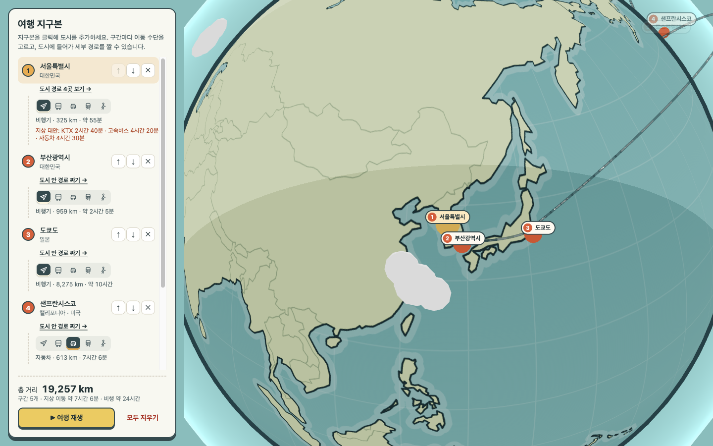
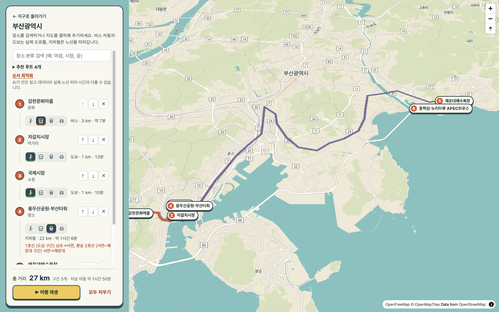
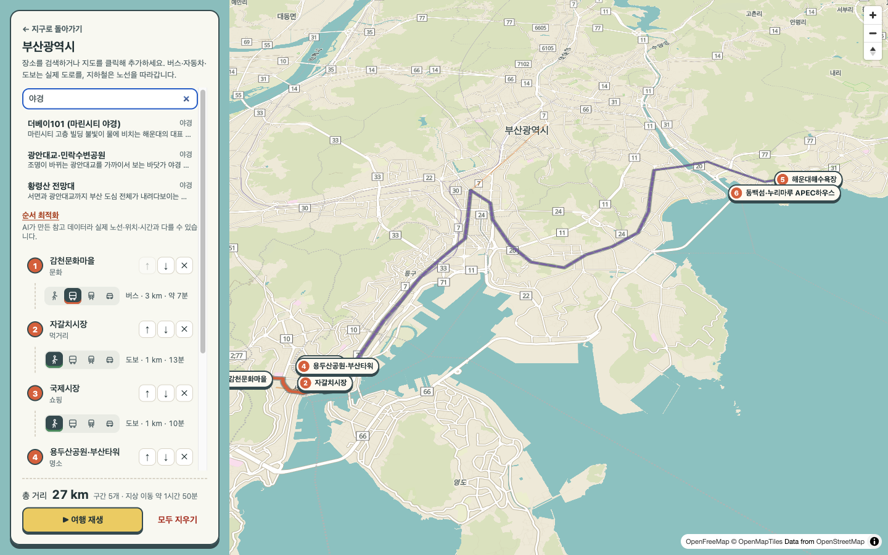

# 여행 지구본

여행 경로를 작은 지구본 위에 그리는 웹 앱입니다. 지구본에서는 나라를 고른 뒤 도시를 골라 나라 사이 경로를 잇고, 도시에 들어가면 실제 지도 위에서 정류장·명소 사이를 버스·지하철·도보·자동차로 잇습니다. 지구본의 그림체는 [Messenger](https://messenger.abeto.co/)처럼 툰 셰이딩과 외곽선을 쓴 "작은 세계"입니다.



## 스크린샷

| 도시 화면: 추천 루트와 지하철 경로 | 도시 화면: 장소 검색 |
| --- | --- |
|  |  |


## 실행 방법

### 준비물
- Node.js 20.19 이상 또는 22.12 이상 (Vite 7 요구 사항)
- 인터넷 연결: 도시 지도·도로 경로·주소 조회가 공개 서버를 씁니다. API 키는 필요 없습니다. 연결이 없으면 도로 경로는 직선으로 대신 그리고 이유를 표시합니다.

### 처음 실행

```bash
git clone https://github.com/Kim-soung-won/3D-travel.git
cd 3D-travel
npm install
npm run dev
```

터미널에 나온 주소(기본 http://localhost:5173)를 브라우저로 엽니다.

### 써 보기
1. 왼쪽 패널의 **[예시 경로 불러오기]** 를 누릅니다. 서울 → 부산 → 도쿄 → 샌프란시스코 → 로스앤젤레스 → 파리 경로가 그려집니다.
2. 도시마다 [−][+]로 숙박 수를 바꿔 보고, **[▶ 여행 재생]** 으로 이동과 숙박을 따라가 봅니다. Esc로 멈춥니다.
3. 부산의 **[도시 안 경로 짜기 →]** 를 누르면 도시 지도로 바뀝니다.
4. **추천 루트**에서 [불러오기]를 누르거나, 검색창에 "야경", "시장"처럼 입력해 장소를 추가합니다. 경유지가 3곳 이상이면 **[순서 최적화]** 를 쓸 수 있습니다.
5. 지구본에서 나라를 누르면 그 나라가 칠해지고 주요 도시 목록이 나옵니다. 목록에서 도시를 눌러 추가합니다(지구본의 점은 위치를 보여 줄 뿐 누를 수 없습니다). Esc나 [×]로 닫습니다.

### 배포 (Cloudflare Pages)
다른 사람이 공유 링크를 열려면 앱이 인터넷에 올라가 있어야 합니다. 계정 연결은 직접 해야 합니다.
1. [Cloudflare 대시보드](https://dash.cloudflare.com/)에서 Workers & Pages → 만들기 → Pages → **Git에 연결**을 고릅니다.
2. GitHub 권한을 허용합니다. 저장소는 `Kim-soung-won/3D-travel`만 골라도 됩니다.
3. 빌드 설정:

   | 항목 | 값 |
   | --- | --- |
   | 프레임워크 프리셋 | Vite (없으면 None) |
   | 빌드 명령 | `npm run build` |
   | 빌드 출력 디렉터리 | `dist` |
   | Node 버전 | 저장소의 `.node-version`(22)을 따릅니다. 안 되면 환경 변수 `NODE_VERSION=22` |

4. 저장하고 배포하면 `https://<프로젝트 이름>.pages.dev` 주소가 생깁니다.
   - 이후 `main`에 push할 때마다 자동으로 다시 배포됩니다.
   - 다른 브랜치는 미리보기 주소로 배포됩니다.

대시보드 메뉴 이름은 바뀔 수 있습니다. 서버나 API 키는 필요 없습니다.

### 그 밖의 명령

```bash
npm test           # 단위 테스트 (지리 계산, 경로 상태, 지하철 경로, 사전 데이터 검사)
npm run build      # 타입 검사 + 배포용 빌드 (dist/)
npm run preview    # 빌드 결과를 로컬에서 확인
```

## 기능 (v0.3)

### 지구본 화면
- **지구본:** 끌어서 돌리고 휠로 확대합니다. 경유지가 없으면 천천히 혼자 돌고, 지구본 위에 포인터를 두거나 조작하는 동안에는 멈춥니다.
- **경유지 추가:** 지구본에서 나라를 누르면 카메라가 그 나라로 다가가고, 패널에 인구순 주요 도시(최대 20곳, 수도 표시)가 나옵니다. 목록에서 도시를 누르면 경유지 끝에 들어갑니다. 목록 위 검색 칸에서는 그 나라의 작은 도시까지 한국어·영어 이름으로 찾습니다. 지구본에 없는 작은 나라(싱가포르·홍콩·모나코 등)는 가까운 나라(말레이시아·중국·프랑스) 목록에 그 나라 이름과 함께 들어 있습니다. 지구본에는 그 도시들이 점으로 찍히고, 점에 포인터를 올리면 목록의 같은 줄이 강조됩니다. 지구본 클릭은 늘 나라 고르기라 점을 눌러도 도시가 들어가지 않습니다. 바다를 누르면 고른 나라가 풀립니다. 도시 목록은 [Natural Earth](https://www.naturalearthdata.com/)(퍼블릭 도메인)에서 만들었습니다.
- **경로·수단:** 구간마다 비행기·기차·버스·자동차·지하철·도보를 고릅니다. 비행기는 거리에 따라 솟은 대권 곡선, 버스·자동차·도보는 실제 도로를 따른 선입니다. 기차는 철도 경로 데이터가 없어 지표 직선(점선)으로 그리고, 참고 데이터가 있는 구간(서울–부산 KTX, 도쿄–오사카 신칸센, 런던–파리 유로스타 등)은 그 시간을, 없으면 평균 시속 90km로 어림합니다. 바다를 80km 넘게 건너는 구간(서울–도쿄 등)에서는 기차를 고를 수 없고, 누르면 이유를 보입니다. 구간 거리와 총 거리는 하버사인 공식으로 계산합니다.
- **목록 편집:** 이름을 바꾸고, 순서를 위아래로 옮기고, 삭제할 수 있습니다. 목록에서 경유지를 고르면 카메라가 그곳으로 날아갑니다. 지구본의 도시 핀을 두 번 누르면 그 도시 화면으로 들어갑니다.
- **링크 붙이기:** 목록에서 경유지를 고르면 링크 칸이 나옵니다. 구글 지도 등의 주소를 붙여 넣으면 목록과 지구본·도시 지도의 마커에 [↗] 단추가 생겨 새 탭에서 엽니다. [구글 지도에서 찾기]로 그 장소를 검색해 링크를 복사해 올 수 있습니다. http·https 주소만 받습니다. 링크는 공유 링크·파일에도 들어갑니다.
- **몇 박 며칠:** 도시마다 [−][+]로 묵을 밤 수를 정합니다. 도시별 "1~3일차"와 전체 "11박 12일"이 바로 계산됩니다. 숙박이 0이면 당일 들름입니다.
- **시간 단위 일정:** 패널 위에서 첫 도시 도착 날짜(비워도 됨)와 시각을 정합니다. 숙박하는 도시는 출발 시각(기본 10:00), 당일 들르는 도시는 머무는 시간(기본 3시간, 30분 단위)을 정합니다. 구간 이동 시간을 더해 도시마다 "10/25(일) 04:00"처럼 **현지 시각**으로 도착·출발이 계산됩니다. 시간대는 좌표로 찾아(@photostructure/tz-lookup) 시차·서머타임·날짜 변경선이 반영됩니다. 비행 구간에는 공항 수속·대기 2시간을 더합니다.
- **여행 재생:** 이동 구간은 수단 모형(비행기·기차·버스·자동차·지하철·도보)이 경로를 따라갑니다. 숙박하는 도시에서는 카메라가 다가가 숙소와 캐리어를 든 여행자를 보여 주고, 해와 달이 박 수만큼 돕니다. 당일 들르는 도시에서는 사진기를 든 여행자가 보입니다. 패널에는 "3일차 · 도쿄도에서 1/2박"처럼 지금 상태가 나옵니다. Esc로 멈춥니다.
- **지우기:** 삭제와 모두 지우기는 확인 창 없이 바로 실행되고, [되돌리기]가 다음 변경 전까지 남습니다.
- **예시 경로:** 서울 2박(세부 경유지 4곳) → 부산 1박 → 도쿄 2박 → 샌프란시스코 1박 → 로스앤젤레스 2박 → 파리 3박 (11박 12일)
- **도시로 들어가기:** 목록의 [도시 안 경로 짜기 →]를 누르면 로딩 화면을 거쳐 도시 화면으로 바뀝니다. 지구본과 도시 지도는 동시에 떠 있지 않습니다.

### 저장·공유
- **자동 저장:** 일정은 이 브라우저에 자동으로 저장되어 새로고침해도 남습니다.
- **[공유]:** 패널 제목 옆 버튼입니다.
  - **링크:** 일정이 링크 안에 압축되어 들어갑니다(예시 일정 약 590자). 서버에 저장하지 않습니다. 받은 사람이 열면 미리보기가 뜨고, [내 일정으로 가져오기]를 눌러야 바뀝니다.
  - **이미지 카드:** 지구본과 일정표를 담은 1080×1350 PNG입니다. 휴대폰에서는 공유 시트로 바로 보낼 수 있습니다.
  - **파일:** 일정을 `.json`으로 내보내거나 가져옵니다.
- 형식과 설계는 [공유 계획](docs/plan/sharing.md)에 있습니다.

### 도시 화면
- **지도:** MapLibre로 OpenFreeMap 지도(도로·건물·역)를 기울여 보여 줍니다. 지명은 한국어를 먼저 쓰고, 한국어 이름이 없는 해외 라벨은 현지 문자 대신 영어·로마자로 보입니다(국내는 원래 이름이 한글이라 그대로).
- **세부 경유지:** 지도를 클릭하면 추가되고, 주소 조회로 장소·동네 이름이 붙습니다.
- **하루 일정:** 하루 시작 시각(기본 09:00)부터 장소마다 머무는 시간(기본 1시간, 30분 단위)과 구간 이동 시간을 더해 "10:30 – 11:30"처럼 시간표를 보입니다. 패널 위에 끝나는 시각과 전체 시간이 나옵니다.
- **찾기·추천:** 장소 이름이나 분류(야경, 시장, 궁 등)로 검색해 추가합니다. 도시마다 추천 루트 4개를 불러올 수 있고, [순서 최적화]는 첫 지점을 두고 직선 거리가 가장 짧은 순서로 바꿉니다. 모두 되돌릴 수 있습니다.
- **수단:** 버스·자동차·도보는 실제 도로 경로입니다. 지하철은 사전 노선 데이터로 가까운 역까지 걷고 환승을 포함해 노선을 따라갑니다. 경로를 받지 못하면 직선으로 그리고 이유를 적습니다.
- **재생:** 수단 아이콘이 경로를 따라 움직이고 지도가 따라갑니다.
- **화면 폭:** 넓은 화면에서는 왼쪽에 패널을 둡니다. 좁은 화면(720px 이하)에서는 패널이 아래로 내려가고, 지구본은 남은 위쪽 영역에 맞춰 카메라가 물러납니다. 패널 맨 위 손잡이를 누르면 패널을 크게 펼칩니다.

## 구조

| 경로 | 내용 |
| --- | --- |
| `src/geo/geo.ts` | 위경도 ↔ 3D 좌표, 거리, 대권 곡선, 경로 위 점 고르기 |
| `src/geo/world.ts` | 대륙·국경 텍스처 그리기, 좌표 → 나라, 나라 중심·강조 텍스처 |
| `src/data/places.json`, `places-all.json` | 나라별 주요 도시 20곳과 검색용 전체 도시. `scripts/build-places.mjs`로 Natural Earth에서 만든다 |
| `src/geo/modes.ts` | 이동 수단(색·속도·지구본/도시에서 쓸 수 있는지) |
| `src/geo/routing.ts` | 도로 경로 받기(캐시, 실패 시 직선) |
| `src/data/` | 사전 데이터: 도시별 지하철·명소·추천 루트(`cities/*.json`), 도시 간 비행 시간(`intercity.json`), 형식(`types.ts`) |
| `src/geo/transit.ts` | 지하철 경로(역 그래프 + 최단 시간) |
| `src/geo/optimize.ts` | 경유지 순서 최적화 |
| `src/geo/geocode.ts` | 좌표 → 장소 이름(주소 조회, 1.1초 간격) |
| `src/share/` | 공유·저장 형식 v5(`format.ts`), 링크 인코딩(`codec.ts`), 자동 저장(`storage.ts`), 이미지 카드(`card.ts`) |
| `src/state/itinerary.ts` | 몇 박 며칠: 도시별 날짜 범위와 전체 일정 |
| `src/state/route.ts` | 경로 상태(useReducer): 도시 목록과 도시별 세부 경유지, 되돌리기 |
| `src/hooks/useLegs.ts` | 구간 목록 → 구간 경로 |
| `src/scene/` | 지구(툰 셰이딩·외곽선·대기), 구름, 핀과 라벨, 경로선, 수단 모형, 카메라 |
| `src/city/` | 도시 화면(MapLibre). 처음 들어갈 때만 불러오는 별도 청크 |
| `src/ui/` | 목록·수단 고르기·로딩 화면 |

## 기술
- Vite + React 19 + TypeScript
- three.js r180, React Three Fiber 9, drei 10
- 지구본 지도: Natural Earth 1:110m(퍼블릭 도메인), `world-atlas`, `topojson-client`, `d3-geo`
- 도시 지도: MapLibre GL 5 + [OpenFreeMap](https://openfreemap.org/)(OpenStreetMap 데이터)
- 도로 경로: FOSSGIS OSRM(`routing.openstreetmap.de`), 주소 조회: Nominatim
- 키가 필요한 서비스는 쓰지 않습니다. 다만 위 공개 서버들은 시제품 용도로만 쓰고, 실제 서비스로 내려면 자체 서버나 유료 서비스로 바꿔야 합니다.

## 개발 이력·계획
- [계획 (ROADMAP)](docs/plan/ROADMAP.md): 결정할 것, 다음 후보, 알려진 문제
- [개발 이력](docs/history/README.md): 일자별 요약과 작업별 상세

## 사전 데이터 (AI 생성)

서울·부산·제주·도쿄·오사카·교토·타이베이·방콕·싱가포르·런던·파리·뉴욕·샌프란시스코·로스앤젤레스 14곳의 데이터는 LLM(Claude)이 지식으로 만든 **미검증 데이터**입니다. 화면에도 이 사실을 표시합니다.
- **들어 있는 것:** 도시마다 주요 지하철 노선 2~8개(역 23~92개, 제주는 지하철 없음), 명소 24~31곳, 추천 루트 4개. 그리고 도시 쌍 42개의 비행 시간과 지상 대안. 도시 데이터는 그 도시를 열 때 따로 불러옵니다.
- **검사:** `src/data/data.test.ts`가 명백히 지어낸 값을 거릅니다. 역·명소가 도시 범위 안인지, 이웃 역 간격이 0.2~8km인지, 환승역 좌표가 노선끼리 0.6km 안인지, 추천 루트 참조가 맞는지를 봅니다. 사실 여부까지는 확인하지 못합니다.
- **정확도:** 좌표는 대체로 수십~수백 m 오차가 있을 수 있습니다. 일부 노선은 도심 구간만 넣었고, 최근 연장 구간은 확실하지 않아 뺐습니다.
- **시간 어림:** 지하철은 역까지 도보(시속 4.5km, 직선의 1.3배) + 첫 대기 4분 + 역마다 정차 0.4분 + 운행 시속 40km + 환승 5분입니다. 비행은 이륙~착륙 시간이고, 앱이 공항 수속·대기 2시간을 더합니다.
- **고치려면:** `cities/<도시>.json`을 고친 뒤 `npm test`를 돌립니다.

## 아직 없는 것·알려진 한계
- **지구본 장소 검색:** 나라를 먼저 고른 뒤 그 나라 안에서만 찾습니다. 전 세계 이름 검색은 없습니다. 지구본에서 300km보다 먼 섬나라(몰디브 등)는 넣을 수 없습니다.
- **공유:** 공유한 뒤 고친 내용은 링크에 반영되지 않습니다(링크는 그 순간의 사본). 짧은 링크·공동 편집은 서버가 필요해 아직 없습니다.
- **일정:** 메모가 없습니다. 도시 안 일정은 머무는 날마다 나뉘고 도착·출발 시각과 이어집니다. 지도 재생은 모든 날 또는 고른 하루만 돌립니다.
- **해외 지도 라벨:** OpenStreetMap에 한국어·로마자 이름이 없는 라벨은 현지 문자로 나옵니다. 도쿄는 가게·도로의 약 40%가 그렇습니다. 데이터의 한계라 앱에서 채울 수 없습니다.
- **세밀한 지도:** 지구본은 1:110m 지도라 작은 섬은 나오지 않습니다.
- **지하철:** 데이터가 있는 13개 도시만 노선을 따릅니다. 다른 도시는 직선으로 그리고 평균 속도(시속 32km)로 어림합니다. 시간표가 아니라 평균값이라 배차·급행은 반영하지 않습니다.
- **실시간 AI 없음:** 검색과 추천은 미리 만든 데이터 안에서만 찾습니다.
- **라벨 겹침:** 가까운 도시 라벨·마커는 위로 띄워 세로줄로 잇습니다. 아주 많이 겹치면(240px 넘게 띄워야 하면) 제자리에 둡니다.
