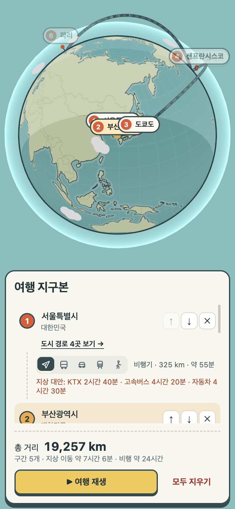

# 여행 지구본

여행 경로를 작은 지구본 위에 그리는 웹 앱입니다. 지구본에서는 도시를 찍어 나라 사이 경로를 잇고, 도시에 들어가면 실제 지도 위에서 정류장·명소 사이를 버스·지하철·도보·자동차로 잇습니다. 지구본의 그림체는 [Messenger](https://messenger.abeto.co/)처럼 툰 셰이딩과 외곽선을 쓴 "작은 세계"입니다.


## 스크린샷

| 도시 화면: 추천 루트와 지하철 경로 | 도시 화면: 장소 검색 |
| --- | --- |
|  |  |



## 실행 방법

### 준비물
- Node.js 20.19 이상 또는 22.12 이상 (Vite 7 요구 사항)
- 인터넷 연결: 도시 지도·도로 경로·주소 조회가 공개 서버를 씁니다. API 키는 필요 없습니다. 연결이 없으면 도로 경로는 직선으로 대신 그리고 이유를 표시합니다.

### 처음 실행

```bash
git clone https://github.com/Kim-soung-won/3D-travel.git
cd 3D-travel
npm install
npm run dev
```

터미널에 나온 주소(기본 http://localhost:5173)를 브라우저로 엽니다.

### 써 보기
1. 왼쪽 패널의 **[예시 경로 불러오기]** 를 누릅니다. 서울 → 부산 → 도쿄 → 샌프란시스코 → 로스앤젤레스 → 파리 경로가 그려집니다.
2. **[▶ 여행 재생]** 으로 경로를 따라가 봅니다. Esc로 멈춥니다.
3. 부산의 **[도시 안 경로 짜기 →]** 를 누르면 도시 지도로 바뀝니다.
4. **추천 루트**에서 [불러오기]를 누르거나, 검색창에 "야경", "시장"처럼 입력해 장소를 추가합니다. 경유지가 3곳 이상이면 **[순서 최적화]** 를 쓸 수 있습니다.
5. 지구본을 직접 클릭하면 그 지점이 경유지로 추가됩니다.

### 그 밖의 명령

```bash
npm test           # 단위 테스트 (지리 계산, 경로 상태, 지하철 경로, 사전 데이터 검사)
npm run build      # 타입 검사 + 배포용 빌드 (dist/)
npm run preview    # 빌드 결과를 로컬에서 확인
```

## 기능 (v0.2)

### 지구본 화면
- **지구본:** 끌어서 돌리고 휠로 확대합니다. 경유지가 없으면 천천히 혼자 돕니다.
- **경유지 추가:** 지구본을 클릭하면 경유지가 추가되고, 그 지점이 속한 나라 이름이 붙습니다. 바다면 "바다 위 지점"입니다.
- **경로·수단:** 구간마다 비행기·버스·자동차·지하철·도보를 고릅니다. 비행기는 거리에 따라 솟은 대권 곡선, 버스·자동차·도보는 실제 도로를 따른 선입니다. 구간 거리와 총 거리는 하버사인 공식으로 계산합니다.
- **목록 편집:** 이름을 바꾸고, 순서를 위아래로 옮기고, 삭제할 수 있습니다. 목록에서 경유지를 고르면 카메라가 그곳으로 날아갑니다.
- **여행 재생:** 구간 수단에 맞는 모형이 전체 경로를 따라가고, 카메라가 따라갑니다. Esc로 멈춥니다.
- **지우기:** 삭제와 모두 지우기는 확인 창 없이 바로 실행되고, [되돌리기]가 다음 변경 전까지 남습니다.
- **예시 경로:** 서울(세부 경유지 4곳) → 부산 → 도쿄 → 샌프란시스코 → 로스앤젤레스 → 파리
- **도시로 들어가기:** 목록의 [도시 안 경로 짜기 →]를 누르면 로딩 화면을 거쳐 도시 화면으로 바뀝니다. 지구본과 도시 지도는 동시에 떠 있지 않습니다.

### 도시 화면
- **지도:** MapLibre로 OpenFreeMap 지도(도로·건물·역)를 기울여 보여 줍니다. 지명은 한국어를 먼저 씁니다.
- **세부 경유지:** 지도를 클릭하면 추가되고, 주소 조회로 장소·동네 이름이 붙습니다.
- **찾기·추천:** 장소 이름이나 분류(야경, 시장, 궁 등)로 검색해 추가합니다. 도시마다 추천 루트 4개를 불러올 수 있고, [순서 최적화]는 첫 지점을 두고 직선 거리가 가장 짧은 순서로 바꿉니다. 모두 되돌릴 수 있습니다.
- **수단:** 버스·자동차·도보는 실제 도로 경로입니다. 지하철은 사전 노선 데이터로 가까운 역까지 걷고 환승을 포함해 노선을 따라갑니다. 경로를 받지 못하면 직선으로 그리고 이유를 적습니다.
- **재생:** 수단 아이콘이 경로를 따라 움직이고 지도가 따라갑니다.
- **화면 폭:** 넓은 화면에서는 왼쪽에 패널을 둡니다. 좁은 화면(720px 이하)에서는 패널이 아래로 내려가고, 지구본은 남은 위쪽 영역에 맞춰 카메라가 물러납니다.

## 구조

| 경로 | 내용 |
| --- | --- |
| `src/geo/geo.ts` | 위경도 ↔ 3D 좌표, 거리, 대권 곡선, 경로 위 점 고르기 |
| `src/geo/world.ts` | 대륙·국경 텍스처 그리기, 좌표 → 나라 이름 |
| `src/geo/modes.ts` | 이동 수단(색·속도·지구본/도시에서 쓸 수 있는지) |
| `src/geo/routing.ts` | 도로 경로 받기(캐시, 실패 시 직선) |
| `src/data/` | 사전 데이터: 도시별 지하철·명소·추천 루트(`cities/*.json`), 도시 간 비행 시간(`intercity.json`), 형식(`types.ts`) |
| `src/geo/transit.ts` | 지하철 경로(역 그래프 + 최단 시간) |
| `src/geo/optimize.ts` | 경유지 순서 최적화 |
| `src/geo/geocode.ts` | 좌표 → 장소 이름(주소 조회, 1.1초 간격) |
| `src/state/route.ts` | 경로 상태(useReducer): 도시 목록과 도시별 세부 경유지, 되돌리기 |
| `src/hooks/useLegs.ts` | 구간 목록 → 구간 경로 |
| `src/scene/` | 지구(툰 셰이딩·외곽선·대기), 구름, 핀과 라벨, 경로선, 수단 모형, 카메라 |
| `src/city/` | 도시 화면(MapLibre). 처음 들어갈 때만 불러오는 별도 청크 |
| `src/ui/` | 목록·수단 고르기·로딩 화면 |

## 기술
- Vite + React 19 + TypeScript
- three.js r180, React Three Fiber 9, drei 10
- 지구본 지도: Natural Earth 1:110m(퍼블릭 도메인), `world-atlas`, `topojson-client`, `d3-geo`
- 도시 지도: MapLibre GL 5 + [OpenFreeMap](https://openfreemap.org/)(OpenStreetMap 데이터)
- 도로 경로: FOSSGIS OSRM(`routing.openstreetmap.de`), 주소 조회: Nominatim
- 키가 필요한 서비스는 쓰지 않습니다. 다만 위 공개 서버들은 시제품 용도로만 쓰고, 실제 서비스로 내려면 자체 서버나 유료 서비스로 바꿔야 합니다.

## 개발 이력·계획
- [계획 (ROADMAP)](docs/plan/ROADMAP.md): 결정할 것, 다음 후보, 알려진 문제
- [개발 이력](docs/history/README.md): 일자별 요약과 작업별 상세

## 사전 데이터 (AI 생성)

서울·부산·도쿄·샌프란시스코·로스앤젤레스·파리의 데이터는 LLM(Claude)이 지식으로 만든 **미검증 데이터**입니다. 화면에도 이 사실을 표시합니다.
- **들어 있는 것:** 도시마다 주요 지하철 노선 2~5개(역 34~92개), 명소 24~29곳, 추천 루트 4개. 그리고 도시 쌍 12개의 비행 시간과 지상 대안.
- **검사:** `src/data/data.test.ts`가 명백히 지어낸 값을 거릅니다. 역·명소가 도시 범위 안인지, 이웃 역 간격이 0.2~8km인지, 환승역 좌표가 노선끼리 0.6km 안인지, 추천 루트 참조가 맞는지를 봅니다. 사실 여부까지는 확인하지 못합니다.
- **정확도:** 좌표는 대체로 수십~수백 m 오차가 있을 수 있습니다. 일부 노선은 도심 구간만 넣었고, 최근 연장 구간은 확실하지 않아 뺐습니다.
- **시간 어림:** 지하철은 역까지 도보(시속 4.5km, 직선의 1.3배) + 첫 대기 4분 + 역마다 정차 0.4분 + 운행 시속 40km + 환승 5분입니다. 비행은 이륙~착륙 시간이며 탑승·대기 시간은 빠져 있습니다.
- **고치려면:** `cities/<도시>.json`을 고친 뒤 `npm test`를 돌립니다.

## 아직 없는 것·알려진 한계
- **장소 검색:** 지명으로 검색하려면 지오코딩 API가 필요합니다.
- **저장·공유:** 일정, 날짜, 메모, 저장, 공유 링크가 없습니다.
- **국가 이름:** 일부만 한국어이고, 나머지는 영어로 나옵니다.
- **세밀한 지도:** 지구본은 1:110m 지도라 작은 섬은 나오지 않습니다.
- **지하철:** 데이터가 있는 6개 도시만 노선을 따릅니다. 다른 도시는 직선으로 그리고 평균 속도(시속 32km)로 어림합니다. 시간표가 아니라 평균값이라 배차·급행은 반영하지 않습니다.
- **실시간 AI 없음:** 검색과 추천은 미리 만든 데이터 안에서만 찾습니다.
- **라벨 겹침:** 가까운 도시(서울·부산)는 지구본을 멀리서 보면 라벨이 겹칩니다.
